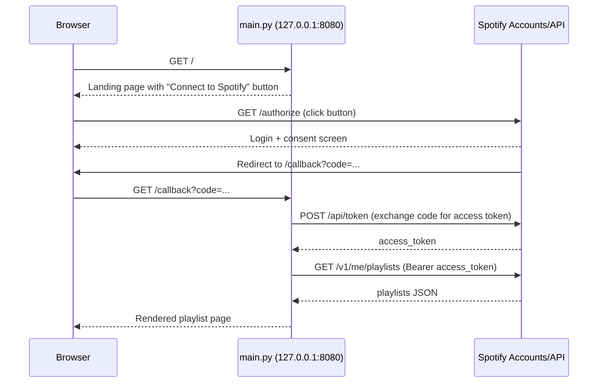

# spotify-oauth
Small demo app demonstrating Spotify OAuth

Minimal Python example that walks through Spotify's OAuth Authorization Code flow by hand,
using only `requests` and the standard library (no OAuth library), to log in and list the
current user's playlists. Written for learning how OAuth actually works under the hood.

## Setup

1. Create an app at the [Spotify Developer Dashboard](https://developer.spotify.com/dashboard) and add
   `http://127.0.0.1:8080/callback` as a Redirect URI.
2. Copy `.env.example` to `.env` and fill in your Client ID and Client Secret.
3. Create a virtual environment and install dependencies:

   ```bash
   python3 -m venv .venv
   .venv/bin/pip install -r requirements.txt
   ```

## Run it

```bash
export $(cat .env | xargs)
.venv/bin/python main.py
```

This opens `http://127.0.0.1:8080/` in your browser with a "Connect to Spotify" button.
Click it, authorize the app, and you'll be redirected back to a page that lists your
playlists.

## Run it with Docker

```bash
docker build -t spotify-oauth .
docker run --rm -p 8080:8080 \
  -e SPOTIFY_CLIENT_ID=your_client_id_here \
  -e SPOTIFY_CLIENT_SECRET=your_client_secret_here \
  spotify-oauth
```

The container has no GUI browser, so open `http://127.0.0.1:8080/` yourself once it's running.

## Deploy to Azure Functions

`function_app.py` serves the same pages as an Azure Functions (Python v2 model) app, and
`.github/workflows/deploy-azure-functions.yml` deploys it on every push to `main`.
Because functions are stateless, the OAuth `state` is kept in a short-lived cookie.

One-time setup:

1. Create a Linux Python 3.12 Function App (e.g. `az functionapp create --runtime python --runtime-version 3.12 --os-type linux ...`).
2. Set its app settings `SPOTIFY_CLIENT_ID`, `SPOTIFY_CLIENT_SECRET` and
   `SPOTIFY_REDIRECT_URI=https://<app-name>.azurewebsites.net/callback`, and add that same
   Redirect URI to your Spotify app.
3. Create a Microsoft Entra app registration with a federated credential for this repo's `main`
   branch, and give it the Contributor role on the Function App.
4. In the GitHub repo, add the secrets `AZURE_CLIENT_ID`, `AZURE_TENANT_ID`, `AZURE_SUBSCRIPTION_ID`
   and the variable `AZURE_FUNCTIONAPP_NAME`.

## How it works


