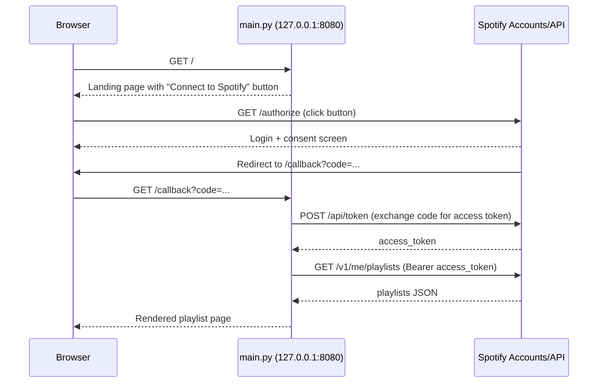

# spotify-oauth
Small demo app demonstrating Spotify OAuth

Minimal Python example that walks through Spotify's OAuth Authorization Code flow by hand,
using only `requests` and the standard library (no OAuth library), to log in and list the
current user's playlists. Written for learning how OAuth actually works under the hood.

**Live demo:** https://spotify-oauth.azurewebsites.net/ (deployed to Azure Functions, see [below](#deploy-to-azure-functions)).

## Setup

1. Create an app at the [Spotify Developer Dashboard](https://developer.spotify.com/dashboard) and add
   `http://127.0.0.1:8080/callback` as a Redirect URI.
2. Copy `.env.example` to `.env` and fill in your Client ID and Client Secret.
3. Create a virtual environment and install dependencies:

   ```bash
   python3 -m venv .venv
   .venv/bin/pip install -r requirements.txt
   ```

## Run it

```bash
export $(cat .env | xargs)
.venv/bin/python main.py
```

This opens `http://127.0.0.1:8080/` in your browser with a "Connect to Spotify" button.
Click it, authorize the app, and you'll be redirected back to a page that lists your
playlists.

## Run it with Docker

```bash
docker build -t spotify-oauth .
docker run --rm -p 8080:8080 \
  -e SPOTIFY_CLIENT_ID=your_client_id_here \
  -e SPOTIFY_CLIENT_SECRET=your_client_secret_here \
  spotify-oauth
```

The container has no GUI browser, so open `http://127.0.0.1:8080/` yourself once it's running.

Or, with Docker Compose (reads the credentials from `.env`):

```bash
docker compose up --build
```

## Deploy to Azure Functions

`function_app.py` serves the same pages as an Azure Functions (Python v2 model) app.
Because functions are stateless, the OAuth `state` is kept in a short-lived cookie.

On every push to `main`, `.github/workflows/deploy-azure-functions.yml`:

1. provisions the Function App (Flex Consumption plan), its storage account and Application
   Insights from `infra/main.bicep`, including all app settings, and
2. deploys the code to it.

One-time setup:

1. Run the bootstrap script (after `az login`). It creates the resource group and an Entra app
   that GitHub Actions logs in as via OIDC, with Contributor on that resource group only:

   ```bash
   infra/bootstrap.sh spotify-oauth-rg westeurope MaxHorstmann/spotify-oauth
   ```

2. Set the GitHub secrets and variables it prints, picking a globally unique
   `AZURE_FUNCTIONAPP_NAME`.
3. Add `https://<AZURE_FUNCTIONAPP_NAME>.azurewebsites.net/callback` as a Redirect URI in your
   Spotify app.

## How it works


